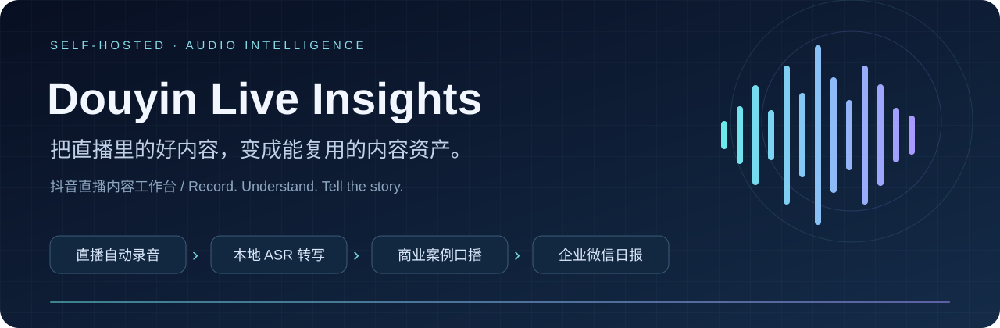
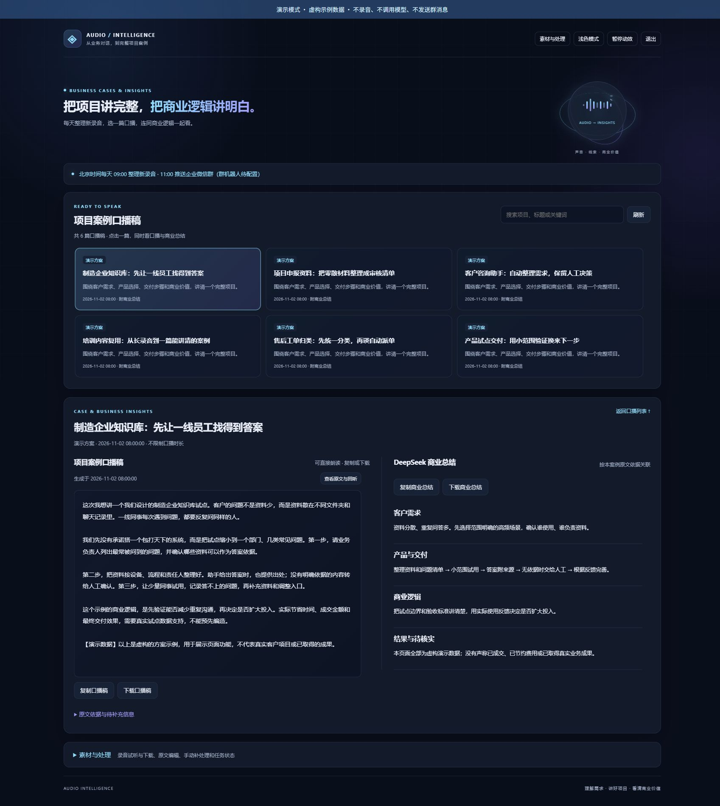

<div align="center">

# Douyin Live Insights

**Turn live conversations into reusable business stories.**

Audio recording → local ASR → business insights → narration scripts → WeCom digest

[简体中文](README.md) · [GitHub](https://github.com/yuehua-meng/douyin-live-insights) · [Gitee](https://gitee.com/kongbaiblank/douyin-live-insights) · [MIT](LICENSE)



</div>

A self-hosted workspace for recording a configured Douyin live room, transcribing audio locally, and turning relevant discussions into evidence-linked business summaries and first-person narration scripts with DeepSeek.

## Try the interface

```bash
git clone https://github.com/yuehua-meng/douyin-live-insights.git
cd douyin-live-insights
python tools/demo.py
```

Open **http://127.0.0.1:8788/**. Python 3.12+ is recommended. The read-only demo uses the standard library and fictional data. It does not record, call an LLM, or send messages.



## Features

- Single-room monitoring, audio segmentation, reconnect handling and invalid-audio isolation.
- Local CPU ASR with FunASR ONNX / Paraformer, VAD and punctuation restoration.
- Business-focused summaries and narration scripts with source references and explicit missing information.
- Searchable case cards with the corresponding summary displayed alongside each script.
- Audio playback, transcript editing, export, task state and budget estimates.
- Daily processing and WeCom delivery through either a group webhook or a long-connection smart bot.
- FastAPI, SQLite, plain HTML/CSS/JavaScript and Linux systemd deployment.

## Configure a live room

Use the **verified desktop live-room URL** from your browser, normally `https://live.douyin.com/...`. A Douyin account ID is not necessarily a live-room path. Profile URLs and `v.douyin.com` short links are not accepted as direct recorder configuration.

Copy `config.example.toml` (Linux) or `config.windows.example.toml` (Windows) to `config.toml`, fill `target.room_url`, and choose output directories. The `douyin_id` field is a local archive label; it does not search for an account.

```bash
# Ubuntu: install python3-venv and ffmpeg first
python3 -m venv .venv
.venv/bin/pip install -r requirements.txt
.venv/bin/python recorder.py --config config.toml --once --max-seconds 15
```

Test while the streamer is live and listen to the output. Remove the two test flags to monitor continuously. See the illustrated [room configuration guide](docs/live-room-setup.md) and [full deployment guide](docs/deployment.md) (Chinese).

## Important boundaries

The recording contains the mixed audio heard by a viewer, not separate speaker tracks or video. Platform changes, region restrictions and anti-bot checks can affect stream resolution. ASR and LLM output require review; discussions must not be presented as completed commercial successes without evidence.

Local ASR consumes server resources. DeepSeek requests are billed by the provider; configured budgets are estimates, not an invoice. Recorded audio stays on your server for ASR; relevant transcript text is sent to DeepSeek for analysis. Use only content you have permission to process.

Current scope is one room per recorder and a single administrator. Multi-room management, speaker diarization and multi-tenant access control are not implemented.

## Contribute

Bug reports, reproducible tests, deployment improvements and content-quality feedback are welcome. Please read [CONTRIBUTING.md](CONTRIBUTING.md) and never include credentials or private recordings in an issue.

If this project saves you time, a **Star** helps others discover it. The code is MIT licensed; dependencies and model weights retain their own licenses.
