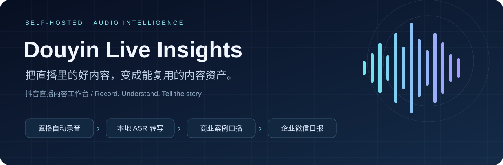
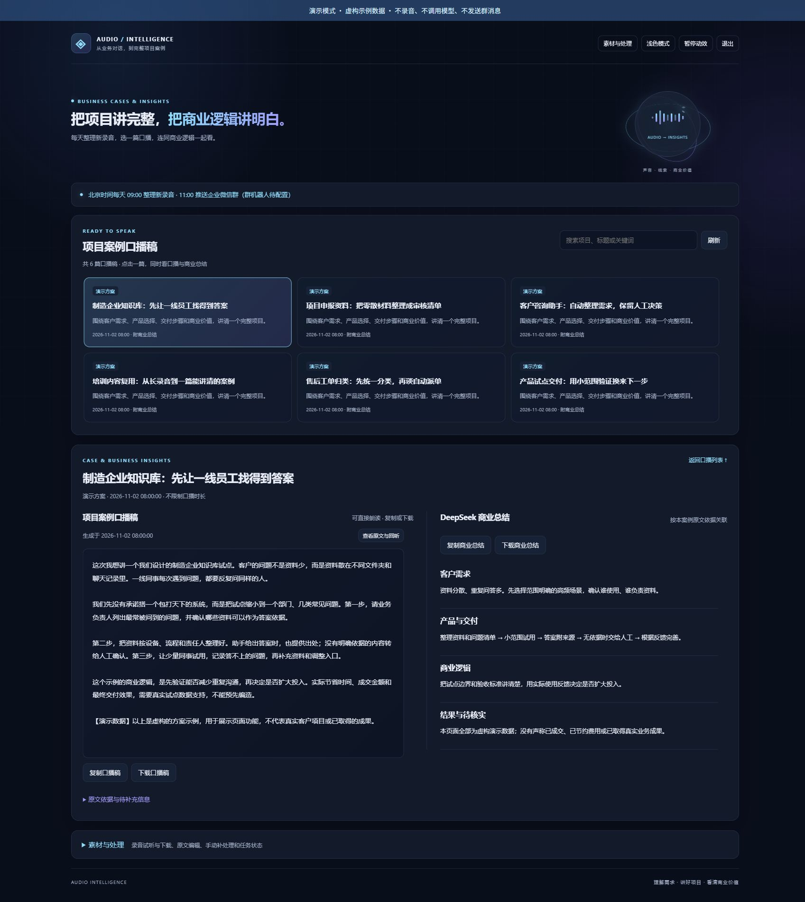
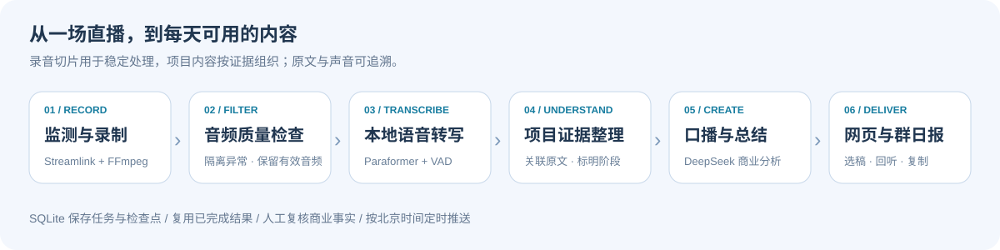

<div align="center">



# 抖音直播内容工作台

**直播结束了，有价值的内容才刚开始。**

自动录音 · 本地转文字 · 商业案例提炼 · 第一人称口播 · 企业微信日报

[](https://www.python.org/)
[](LICENSE)
[](docs/deployment.md)
[](https://github.com/yuehua-meng/douyin-live-insights/actions/workflows/tests.yml)
[](https://github.com/yuehua-meng/douyin-live-insights)

[快速体验](#-先看效果不需要密钥) · [配置直播间](docs/live-room-setup.md) · [完整部署](docs/deployment.md) · [企业微信日报](docs/wecom.md) · [English](README.en.md)

[GitHub](https://github.com/yuehua-meng/douyin-live-insights) / [Gitee 国内镜像](https://gitee.com/kongbaiblank/douyin-live-insights)

</div>

---

## ✨ 把“听过了”，变成“用得上”

一场直播里，可能有客户需求、项目报价、落地方案和经验复盘。真正费时间的，是听完之后再找片段、记要点、整理成可以讲给别人听的内容。

**Douyin Live Insights** 把这条链路放进一个可以自己部署的工作台：监测指定直播间，保存声音，在服务器本地转写，再由 DeepSeek 整理商业逻辑与项目案例口播稿。打开首页，选一篇稿子，旁边就是对应的商业总结。

> **适合谁？** 内容创作者、企业服务团队、直播复盘人员，以及希望从业务对话中沉淀知识的人。当前录制器面向单个直播间；多房间需独立配置、进程与输出目录。



*实际前端界面，使用虚构演示数据；不包含任何真实录音、客户资料或线上账号。*

## 🎯 你能拿到什么

| 能力 | 实际用途 |
| --- | --- |
| **自动监测开播** | 定时检查直播间，有可播放音频时开始录制，断流后重试 |
| **连麦声音一起保存** | 录下观众端收到的混合音轨；房主和连麦人的声音在同一份音频里 |
| **分段录制与质量过滤** | 默认每 30 分钟保存一段，检查损坏、无效、近乎静音的音频，隔离异常文件 |
| **开源 ASR 本地转写** | 使用 FunASR ONNX / Paraformer，CPU 可运行，配合 VAD 与标点恢复 |
| **商业总结** | 从需求、产品方案、交付过程、结果与商业价值整理内容，而非只罗列技术点 |
| **项目案例口播稿** | 提炼一个或多个项目，以第一人称讲述；标注讨论、试点等阶段，材料不足时保留待补项 |
| **口播稿列表 + 对应总结** | 搜索并直接点开单篇稿件，同时查看关联总结；关联不足时说明为同批总结 |
| **原文与录音追溯** | 查看证据和时间点、回听、编辑转写，导出 TXT / SRT / JSON / Markdown 等结果 |
| **每日自动整理** | 按北京时间建立录音快照，默认 09:00 处理、11:00 汇总推送 |
| **企业微信日报** | 支持群 Webhook 和智能机器人长连接，推送标题、摘要、全文链接 |
| **任务与费用管理** | SQLite 保存进度、复用转写与模型结果，设定每日及单任务预算，失败状态可查 |
| **可部署的 Web 工作台** | 明暗主题、适度动效、录音卡片、音频试听、任务状态与移动端布局 |

**能力边界也讲清楚：** 不做分离人声或说话人识别；录音不等于视频录像；AI 稿件需要人工复核，不能把“方案讨论”改写成真实成交业绩。直播平台风控、网络和插件变化可能影响解析，首次部署要先录一小段试听。

## 🧭 一条完整的内容生产流程



1. **录制**：Streamlink 解析直播流，FFmpeg 保存混合音频。
2. **筛选**：保存时检查音频，转写后再检查低信息量内容，降低无效分析。
3. **转写**：按音频窗口与语音区间处理，保留原文和时间位置。
4. **分析**：从文字里抽取项目线索和证据，跨片段组织同一项目，再生成商业总结与口播。
5. **使用**：在网页选稿、回听、复制、下载；每天把新增成果送到企业微信群。

音频切片用于稳定处理，**不是每几十秒就生成一篇独立口播**。项目提炼会结合关联素材，避免只剩碎片化观点。详见 [架构与数据流](docs/architecture.md)。

## 🚀 先看效果，不需要密钥

安装 [Python 3.12+](https://www.python.org/)，然后：

```bash
git clone https://github.com/yuehua-meng/douyin-live-insights.git
cd douyin-live-insights
python tools/demo.py
```

打开 [本地演示页面](http://127.0.0.1:8788/)，即可体验口播稿列表和对应总结。演示只依赖 Python 标准库，使用虚构数据，不录制、不调用模型、不发送群消息。按 `Ctrl+C` 退出。

国内用户也可以克隆：

```bash
git clone https://gitee.com/kongbaiblank/douyin-live-insights.git
```

## 🎙️ 录下你的第一个直播间

### 1. 获取真实的直播间地址

主播**正在直播时**，在电脑浏览器进入直播间，复制地址栏里类似下面的 URL：

```text
https://live.douyin.com/你的直播间标识
```

这里必须替换成实际地址，不能把“抖音号”随便拼到 URL 后面。主页地址、视频地址、App 分享短链不是本项目直接使用的配置。**只拿到了 `v.douyin.com` 短链？** 看 [直播间链接获取与排错图解](docs/live-room-setup.md)。

### 2. 安装录音依赖

**Windows / PowerShell**（先体验录制）：

```powershell
python -m venv .venv
.\.venv\Scripts\python.exe -m pip install -r requirements-local.txt
Copy-Item config.windows.example.toml config.toml
```

**Linux / Ubuntu 24.04**：

```bash
sudo apt-get update
sudo apt-get install -y python3-venv ffmpeg
python3 -m venv .venv
.venv/bin/pip install -r requirements.txt
cp config.example.toml config.toml
```

### 3. 编辑 `config.toml`

```toml
[target]
douyin_id = "my-streamer" # 自己取的归档名称，不负责搜索账号
room_url = "https://live.douyin.com/替换为实际直播间标识"

[paths]
recordings_dir = "./recordings"
work_dir = "./work"

[runtime]
poll_seconds = 60       # 检查间隔，秒
segment_seconds = 1800  # 每段 30 分钟
min_free_gb = 5         # 低于此空间时停止继续录制
ffmpeg = "ffmpeg"      # Windows bundled 方案填 "bundled"
```

### 4. 先录 15 秒，再开启长时间监测

```powershell
# Windows
.\.venv\Scripts\python.exe recorder.py --config config.toml --once --max-seconds 15
```

```bash
# Linux
.venv/bin/python recorder.py --config config.toml --once --max-seconds 15
```

开播期间运行测试，检查 `recordings/` 中生成的音频并试听。确认后去掉 `--once --max-seconds 15`，即可持续监测。离线时不会凭空生成录音；过短或无效样本可能被质量过滤器隔离。

**准备 24 小时运行？** 使用 [Linux 常驻部署教程](docs/deployment.md)，通过 systemd 管理服务。**要继续转写、总结、口播和群日报？** 同一份教程包含完整工作台安装步骤，不止是录音脚本。

## 📬 每天自动给团队送一份成果

```text
09:00  收集已经保存完成、尚未处理的新录音
  ↓    本地转写 → 商业分析 → 案例口播 + 总结
11:00  企业微信群收到新增成果目录
  ↓    点击链接 → 登录工作台 → 读稿、看总结、回听
```

11 点前尚未完成的内容保留进度，完成后进入后续日报。首次开启以现有稿件为基线，不默认把全部历史刷进群里。普通断线可重连；发送结果不确定时保留待确认状态，避免盲目重复推送。

支持两种方式：**群 Webhook**，或 **Bot ID + Secret 长连接机器人**。机器人只需绑定一次目标群，关闭自己的电脑不影响 Linux 上的任务。详见 [企业微信配置教程](docs/wecom.md)。

## 🧩 技术组成

| 层 | 组件 |
| --- | --- |
| 直播解析 / 音频处理 | Streamlink、FFmpeg / ffprobe |
| 本地语音识别 | FunASR ONNX、Paraformer、FSMN VAD、CT-Transformer |
| 商业分析 / 口播生成 | DeepSeek API，证据关联、分阶段提炼、结果校验 |
| Web / 后台任务 | FastAPI、原生 HTML/CSS/JavaScript、独立 worker |
| 状态 / 进度 | SQLite、任务队列、检查点、内容版本与结果缓存 |
| 部署 / 推送 | Linux systemd、HTTPS 反向代理、企业微信 Webhook / WebSocket |

**费用在哪里？** 录音和本地 ASR 不调用付费转写 API，但消耗服务器资源。DeepSeek 分析会按 token 收费；网页预算是估算值，真实账单以服务商为准。模型名称与单价可配置，详见 [配置与费用](docs/configuration.md)。

## 📚 文档导航

| 你想做什么 | 从这里开始 |
| --- | --- |
| 配置自己的主播，分清抖音号和直播间地址 | [直播间配置](docs/live-room-setup.md) |
| 在 Linux 上跑完整工作台 | [部署指南](docs/deployment.md) |
| 配置 ASR、DeepSeek、预算与时间 | [配置参考](docs/configuration.md) |
| 每天自动推到企业微信群 | [企业微信接入](docs/wecom.md) |
| 理解项目如何避免碎片化总结 | [架构说明](docs/architecture.md) |
| 排查没有录音、无法登录、任务失败 | [常见问题](docs/faq.md) |
| 提交修复、功能建议或复现问题 | [参与贡献](CONTRIBUTING.md) |

## 🌱 一起把它做得更好

- 当前重点：录制稳定性、内容质量、长任务恢复、日常使用体验。
- 后续方向：多直播间管理、更多 ASR 适配器、更清晰的成本统计、部署体验改进。**这些是方向，不代表已经实现。**
- 如果它帮你省去了反复听录音、找观点、写稿的时间，欢迎点一个 **Star**，也欢迎带着真实使用场景提 Issue 或 PR。

请只处理你有权录制和使用的内容，遵守平台规则及参与者隐私要求。不要把密钥、Cookie、私有录音或客户资料提交到仓库。项目采用 [MIT](LICENSE)；第三方组件和模型权重遵循各自许可证，不随本仓库分发模型权重。

感谢 [Streamlink](https://github.com/streamlink/streamlink)、[FFmpeg](https://ffmpeg.org/)、[FunASR](https://github.com/modelscope/FunASR)、[ModelScope](https://modelscope.cn/)、[FastAPI](https://github.com/fastapi/fastapi)、[DeepSeek](https://api-docs.deepseek.com/) 和 [企业微信官方 SDK](https://github.com/WecomTeam/aibot-node-sdk) 提供的基础能力。
