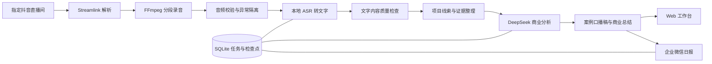

# 架构与内容处理

[返回首页](../README.md)

## 组件如何协作

若托管平台不渲染 Mermaid，可查看首页的 [静态流程图](assets/workflow.svg)。

## 长录音如何交给模型

录制分段、ASR 窗口与商业项目是三个不同层次：

1. **保存片段**：默认每 30 分钟一段，便于归档、恢复与播放。
2. **ASR 窗口**：按 60 秒音频窗口处理，再用 VAD 定位语音区间。检查点允许复用已经完成的识别结果。
3. **项目证据**：从转写中提取候选项目和商业事实，关联原文与时间位置。后续按项目、素材集合组织内容，而非把每个音频小窗口独立变成口播。
4. **商业产出**：把需求、业务选择、产品交付、结果、经验组织成可读总结和第一人称稿件。阶段不同就明确区分，材料不足就标记缺项。

模型输入有长度边界，结果进行结构和证据引用校验；具体策略位于 `analysis/business.py`、`analysis/script.py` 与 `analysis/summarize.py`。超长素材、多项目交叉和转写错误仍可能影响质量，网页保留原文及回听入口供人工复核。

## 进程与目录

| 进程 | 职责 |
| --- | --- |
| `recorder.py` | 检查直播状态、录制、封装、音频质量检查、缓存时长 |
| `analysis.api` | 登录、素材和案例接口、音频范围请求、任务控制 |
| `analysis.worker transcribing` | FFmpeg 预处理、本地 ASR、转写保存 |
| `analysis.worker summarizing` | DeepSeek 分析、总结与口播生成 |
| `analysis.automation` | 扫描素材、日批快照、任务派发、历史复用 |
| `analysis.wecom_bot` | 智能机器人长连接、一次性群绑定、日报发送 |

录制和分析解耦。浏览器关闭不影响已运行的后台进程；但本地终端退出会结束没有被服务管理的本地程序。

## 可靠性与边界

- SQLite 持久化任务、检查点、预算预留及每日发送状态。
- 缓存复用与版本去重减少重复调用，修改素材、模型或提示词版本可能产生新费用。
- ASR 的短尾音频、空识别结果等做边界处理；失败任务保留状态，不以空结果冒充成功。
- 音频质量过滤与文字内容质量检查分层处理；重连中的有效声音仍然保留。
- 日报通过 outbox 占用发送任务。明确拒绝可有限重试；发送超时等不确定结果不盲目重发。
- 单个机器人只保持一个主连接，避免多个部署互相抢占。
- 录音是观众端混合音轨，不包含独立麦位、声纹识别、说话人分离或视频。
- 当前工作台是单管理员模式，未实现企业多租户和细粒度角色权限。
